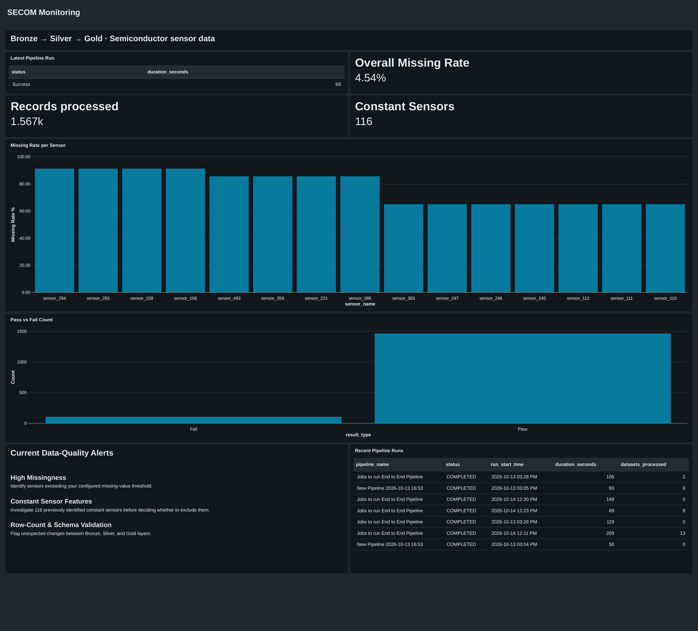

# End-to-End Pipeline for Semiconductor Quality Monitoring

This project implements a Bronze–Silver–Gold data pipeline using the UCI SECOM semiconductor manufacturing dataset. Built in Databricks, it transforms raw sensor readings and quality labels into analysis-ready tables for manufacturing quality monitoring, data quality assessment, and sensor-level analysis.

## Pipeline

- **Bronze** — Ingests and preserves raw sensor readings, quality labels, and timestamps, with an ingestion timestamp added for traceability.
- **Silver** — Cleans and standardizes the data: parses timestamps, maps labels to **Pass** and **Fail**, flags invalid records, assesses sensor completeness, and imputes missing sensor values with the mean.
- **Gold** — Delivers eight business-ready monitoring tables for pass/fail performance, data quality issues, completeness, quality trends, cleaning impact, and sensor statistics and rankings.

## Dataset

[UCI SECOM dataset](https://archive.ics.uci.edu/dataset/179/secom): 1,567 manufacturing records, 590 sensor features, one quality label, and one timestamp per record.

## Dashboard
